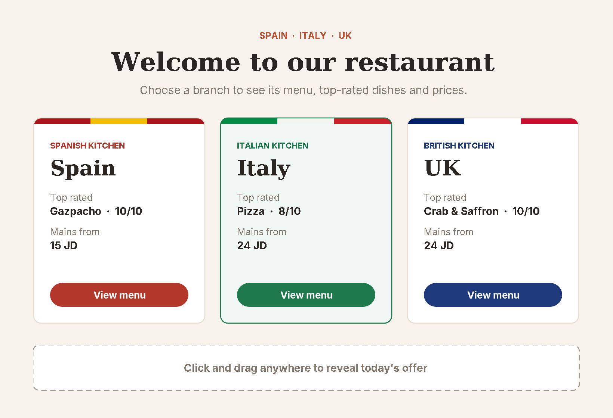
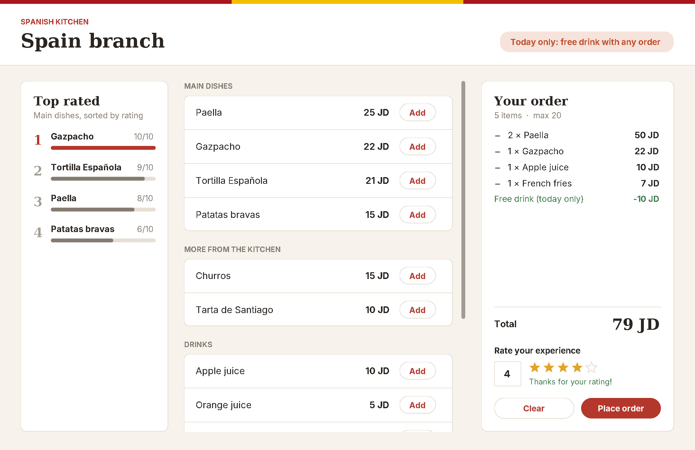
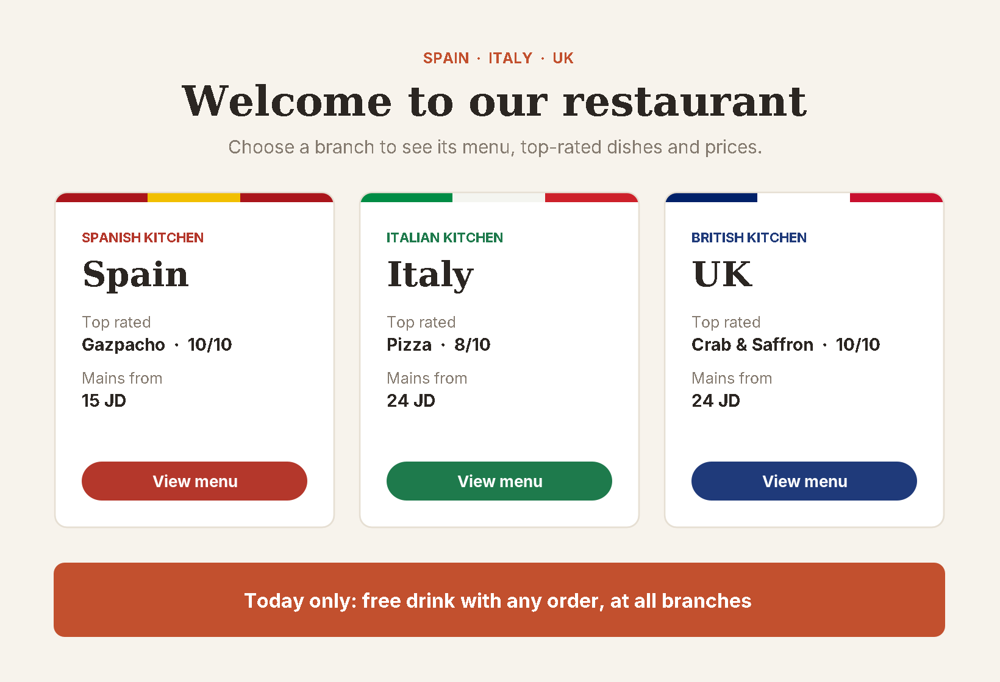

# Restaurant Ordering System

A restaurant ordering app in **Java** with three branches (Spain, Italy and the UK), each with its own menu, prices and dish ratings. Customers choose a branch, see the main dishes ranked by rating, build an order and rate their experience.

The project was built to compare **programming paradigms**: the same system is written in a **procedural** style as a console app and in an **event-driven** style as a **Swing** desktop app.






## Features

- **Three branches**, each with 12 menu items: main dishes, desserts, drinks and sides
- **Top-rated dishes** ranked with a hand-written **selection sort**
- **Ordering** with quantities, a running total and a limit of 20 items per order
- **Today's offer:** a free drink with any order, applied automatically to the total
- **Customer rating** from 1 to 5, with input validation
- **Error handling** so wrong input (letters, out-of-range numbers) never crashes the program

## Two versions, two paradigms

### Procedural (`src/procedural`)

A console program built from static methods and global arrays, run step by step from `main`: choose a branch, print the sorted dishes and menu, take the order, count the items, print the bill and ask for a rating.

```text
main Dishes sorted
Gazpacho (Rating: 10)
Tortilla Española (Rating: 9)
Paella (Rating: 8)
Patatas bravas (Rating: 6)
...
Your order:
Paella x2 = 50 JD
Gazpacho x1 = 22 JD
Apple juice x1 = 10 JD
Total: 82 JD
```

### Event-driven (`src/gui`)

A Swing desktop app where the flow is driven by what the user does instead of a fixed sequence. It uses **inheritance**: `MenuGUI` holds the window, sorting and ordering logic, and `SpainMenuGUI`, `ItalyMenuGUI` and `UKMenuGUI` only supply their own data and colors.

Every type of listener is used:

| Listener | Where | What it does |
|---|---|---|
| `ActionListener` | Buttons | Opens a branch menu, adds items, clears or places the order |
| `MouseListener` | Branch cards | Highlights a card on hover; clicking a card opens its menu |
| `MouseMotionListener` | Start window | Dragging the mouse anywhere reveals today's offer |
| `KeyListener` | Rating box | Blocks non-digit keys, fills in the stars live while typing, submits on Enter |



## Selection sort

Each branch's main dishes are ranked by rating with a selection sort. It works on copies of the arrays, so the menu's original order is never changed:

```java
for (int i = 0; i < tempRatings.length - 1; i++) {
    int max = i;
    for (int j = i + 1; j < tempRatings.length; j++) {
        if (tempRatings[j] > tempRatings[max]) {
            max = j;
        }
    }
    // swap the rating and the dish at positions i and max
}
```

Selection sort was chosen because it's simple to implement and easy to follow, and with only four dishes per branch its O(n²) running time doesn't matter.

## How to run

You need Java 8 or newer. From the project folder:

```bash
javac -d out src/procedural/*.java src/gui/*.java

# console version
java -cp out procedural.Restaurant

# GUI version
java -cp out gui.MainGUI
```

Or open the folder in Eclipse or IntelliJ IDEA and run `Restaurant.java` or `MainGUI.java`.

## Project structure

```
src/
├── procedural/
│   └── Restaurant.java      # Console version: static methods and arrays
└── gui/
    ├── MainGUI.java         # Start window: branch cards and offer
    ├── MenuGUI.java         # Parent class: menu window, sorting, ordering
    ├── SpainMenuGUI.java    # Spain menu data
    ├── ItalyMenuGUI.java    # Italy menu data
    ├── UKMenuGUI.java       # UK menu data
    └── Theme.java           # Colors, fonts and custom-drawn components
```

## Author

**Lujain Naimat** · [GitHub](https://github.com/LujainNaimat)
